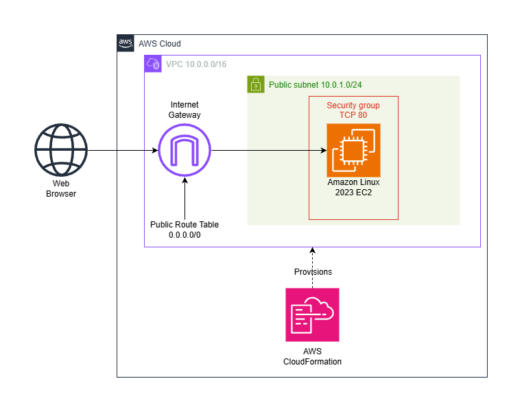
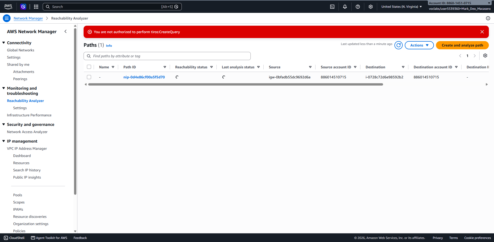
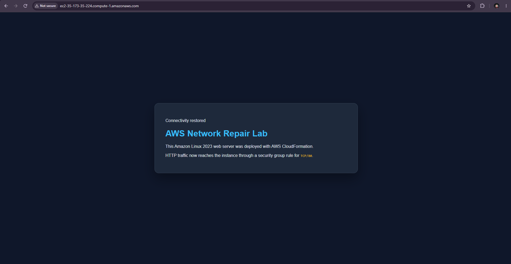

# AWS Network Repair Lab

This project deploys a small AWS web environment with CloudFormation, introduces a deliberate HTTP connectivity failure, diagnoses the blocking component with Amazon VPC Reachability Analyzer, and repairs the infrastructure through code.

## What this demonstrates

- AWS CloudFormation infrastructure as code
- VPC, subnet, internet gateway, route table, and security group relationships
- Amazon EC2 user-data bootstrapping
- Structured network troubleshooting
- Git commits, public repository publishing, and technical documentation

## Architecture



### The Scenario

A deployed AWS CloudFormation stack failed to deliver HTTP traffic to a web server. To isolate where the network flow was blocked, the initial plan was to run an automated path trace using the **VPC Reachability Analyzer**.

### Sandbox Environment Constraint & Diagnostic Pivot

Because this project was deployed inside a secure educational sandbox environment (**AWS Academy**), the managed lab role lacked API permissions to query the underlying route analyzer engine, returning the following authorization error:

`User is not authorized to perform: tiros:CreateQuery`



Instead of letting this halt the troubleshooting process, I executed a **manual firewall inspection** methodology:
1. **Security Group Audit:** I manually navigated to the Amazon EC2 Console and inspected the security group (`WebServerSecurityGroup`) associated with the active web server.
2. **Rule Analysis:** I reviewed the inbound rules table and discovered that **TCP Port 80 (HTTP)** traffic was completely omitted.

### Hypothesis Testing & Drift Prevention

To verify my hypothesis before making template changes:
1. **Manual Ingress Test:** I temporarily added an inbound rule for TCP Port 80 from `0.0.0.0/0` directly in the AWS Console.
2. **Verification:** I attempted to load the web server's public IP address in my browser, which immediately succeeded.
3. **Drift Cleanup:** Leaving direct console modifications in place causes **infrastructure drift**—making our CloudFormation templates inaccurate. To prevent drift and enforce proper DevSecOps standards, I deleted the temporary hot-fix rule to return the environment to its baseline state.

### Infrastructure as Code Resolution

To permanently repair the network, I declared the missing HTTP rule directly in our `infrastructure.yaml` template:

```yaml
SecurityGroupIngress:
  - IpProtocol: tcp
    FromPort: 80
    ToPort: 80
    CidrIp: 0.0.0.0/0
```


I then updated the live stack via CloudFormation. The stack completed successfully, the website came back online, and our templates remain the single source of truth!

## Deployment

1. In AWS CloudFormation, choose Create stack and With new resources (standard).
2. Choose Choose an existing template, Upload a template file, and upload `infrastructure.yaml`.
3. Name the stack `aws-network-repair-lab` and submit it in US East (N. Virginia).
4. When the stack reaches `CREATE_COMPLETE`, open `WebsiteURL` from Outputs.

## Cost awareness

- Reachability Analyzer costs $0.10 per analysis. This project plans two analyses, totaling $0.20 (since I didn't use Reachability Analyzer which was the initial plan, I saved myself $0.20).
- A Linux `t3.micro` in US East (N. Virginia) is listed at $0.0104 per hour.
- The public IPv4 address costs $0.005 per hour.
- CloudFormation adds no charge for the AWS-native `AWS::*` resources in this template. The resources themselves, EBS storage, and applicable data transfer are still billed.

## Security

This repository contains no AWS passwords, access keys, tokens, private keys, or other credentials. The template uses a public Systems Manager parameter to resolve the Amazon Linux 2023 AMI.

## Cleanup

1. In Reachability Analyzer, select the path and choose Actions, Delete path.
2. In CloudFormation, select `aws-network-repair-lab`, choose Delete, and confirm Delete.
3. Use Filter status, Deleted to verify the stack reached `DELETE_COMPLETE`.

## Repository contents

- `infrastructure.yaml`: Final repaired CloudFormation template
- `README.md`: Architecture, diagnosis, repair, costs, and cleanup
- `evidence/`: Before-and-after screenshots and architecture diagram

## Outcome

The final repository proves that I can declare AWS infrastructure, diagnose a network failure with a purpose-built AWS tool, repair the source of truth, verify the result, and communicate the work clearly.